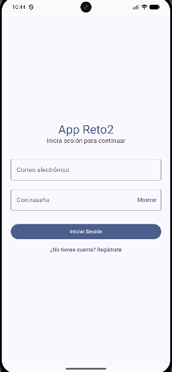

<div align="center">

# 💱 App_Reto2

**Aplicación FinTech nativa para Android con roles de usuario y administrador, operaciones en tiempo real y auditoría de transacciones.**


</div>

---

## 📖 Descripción

**App_Reto2** simula una plataforma de trading de divisas. Los usuarios consultan cotizaciones en vivo, ejecutan órdenes de compra y venta, y siguen su saldo e historial en tiempo real. Un administrador audita cada orden: la aprueba o la rechaza según el margen de precio respecto al mercado, y el saldo del usuario se actualiza de forma atómica.

El proyecto está construido con **Kotlin y Jetpack Compose (sin XML)**, siguiendo **MVVM** y flujos reactivos con **Corrutinas y Flow**.

## 📑 Tabla de contenidos

- [Tech Stack](#-tech-stack)
- [Características principales](#-características-principales)
- [Arquitectura](#-arquitectura)
- [Instalación](#-instalación)
- [Capturas de pantalla](#-capturas-de-pantalla)
- [Notas y limitaciones](#-notas-y-limitaciones)
- [Autor](#-autor)

---

## 🛠 Tech Stack

| Categoría | Tecnología | Uso en el proyecto |
|---|---|---|
| Lenguaje | **Kotlin 2.2.10** | 100 % del código (sin Java) |
| UI | **Jetpack Compose + Material 3** | Interfaz totalmente declarativa, sin XML |
| Arquitectura | **MVVM** | `ViewModel` + `StateFlow` + State Hoisting |
| Navegación | **Navigation Compose** | Rutas tipadas con `sealed class` y protección del backstack |
| Autenticación | **Firebase Authentication** | Registro, login y sesión persistente (Email/Password) |
| Base de datos | **Cloud Firestore** | Perfiles, saldos y transacciones en tiempo real |
| Tiempo real | **OkHttp WebSocket** | Cotizaciones de mercado desde Finnhub |
| Multimedia | **Cloudinary** | Subida de documentos KYC con *unsigned upload preset* |
| Asincronía | **Corrutinas + Flow** | `callbackFlow`, `StateFlow`, `suspendCancellableCoroutine` |
| Serialización | **Kotlinx Serialization** | Parseo de mensajes JSON del WebSocket |
| Build | **Gradle Kotlin DSL + Version Catalog** | AGP 9.3.3, Firebase BoM 34.17.0 |

---

## ✨ Características principales

### 👥 Sistema de roles (User / Admin)
- Cada usuario tiene un perfil en Firestore (`users/{uid}`) con su `role` (`user` o `admin`).
- Tras iniciar sesión se redirige automáticamente al panel correspondiente.
- La sesión persiste entre ejecuciones y se restaura leyendo el rol desde Firestore.
- El cierre de sesión vacía por completo el *backstack*, de modo que el botón "Atrás" no permite volver a pantallas protegidas.

### 📈 Cotizaciones en tiempo real (Finnhub + WebSockets)
- Conexión WebSocket a Finnhub expuesta como `Flow<Double>` mediante `callbackFlow`.
- Un `Interceptor` de OkHttp inyecta el token en cada petición, así que la clave nunca aparece en el código fuente.
- El símbolo se configura desde un único punto (`MarketConfig`), por ejemplo `OANDA:EUR_USD` en producción o `BINANCE:BTCUSDT` para pruebas en fin de semana.

### 🧑‍💼 Panel de Usuario
- **Saldo en vivo**: tarjeta destacada alimentada por un `addSnapshotListener` sobre su documento.
- **Mercado en vivo**: precio actualizado en tiempo real, con opción de reconectar.
- **Compra / Venta**: validación de cantidad y de saldo (`cantidad × precio` no puede superar el saldo en compras).
- **Historial de transacciones**: lista reactiva con indicadores por estado: 🟢 `APPROVED`, 🔴 `REJECTED`, 🟠 `PENDING`.

### 🛡 Panel de Administrador
- Lista en tiempo real de todas las transacciones, separadas en pendientes e historial.
- Precio de mercado en vivo visible en la barra superior.
- **Auditoría automática con margen del 2.5 %**: la orden se aprueba solo si
  `|precioEjecución − precioEnVivo| / precioEnVivo ≤ 0.025`; en caso contrario se rechaza.

### ⚛️ Transacciones atómicas
- La auditoría usa `firestore.runTransaction`: el cambio de estado de la transacción y la actualización del saldo del usuario se confirman juntos o no se confirma ninguno.
- Compra: resta `cantidad × precio de ejecución`. Venta: la suma.
- Si una compra dejaría el saldo en negativo, la orden se rechaza automáticamente sin tocar el saldo.
- Una transacción ya auditada no puede auditarse de nuevo.

### 🪪 KYC (Know Your Customer)
- Selección de imagen con el *Photo Picker* nativo (`PickVisualMedia`).
- Subida a **Cloudinary** con *unsigned upload preset*, sin exponer el API Secret.
- El callback del SDK se convierte en una función `suspend` con `suspendCancellableCoroutine`.
- La `secure_url` resultante se guarda en `users/{uid}.kycDocumentUrl`.

### 🔐 Seguridad
- API Keys y configuración sensible se leen desde `local.properties` (fuera del control de versiones) y se inyectan con `buildConfigField` en `BuildConfig`.
- **Reglas de seguridad de Firestore** por rol:
    - El usuario no puede modificar su `role` ni su `balance`.
    - El administrador solo puede cambiar `status` en transacciones `PENDING` y `balance` en usuarios.
    - Las transacciones solo se crean con `status = PENDING`, a nombre del propio usuario y con marca de tiempo del servidor.

---

## 🏗 Arquitectura

El proyecto sigue **MVVM** con flujo de datos unidireccional y separación por capas:

```
┌──────────────────────────── UI (Jetpack Compose) ────────────────────────────┐
│  Screens (stateless)  ◄── StateFlow<UiState> ──  ViewModel  ── eventos ──►   │
└──────────────────────────────────────┬───────────────────────────────────────┘
                                       │ llama a
┌──────────────────────── Repository (contratos / dominio) ────────────────────┐
│  AuthRepository · UserRepository · TransactionRepository · FinnhubRepository │
│  KycRepository   →  exponen suspend funs y Flow<Resource<T>>                 │
└──────────────────────────────────────┬───────────────────────────────────────┘
                                       │ implementados sobre
┌──────────────────────────────── Data (fuentes) ──────────────────────────────┐
│  Firebase Auth · Firestore · OkHttp WebSocket (Finnhub) · Cloudinary SDK     │
└──────────────────────────────────────────────────────────────────────────────┘
```

### Estructura de paquetes

```
app/src/main/java/com/example/app_reto2/
├── App.kt                   # Inicializa Cloudinary MediaManager
├── MainActivity.kt
├── data/
│   ├── model/               # User, Transaction, DTOs de Finnhub
│   ├── network/             # Cliente OkHttp, interceptor y WebSocket de Finnhub
│   └── repository/          # Interfaces + implementaciones (Auth, User, Transaction, Finnhub, Kyc)
├── navigation/              # Screen (rutas) y AppNavigation (NavHost)
├── ui/
│   ├── auth/                # Login, Registro y AuthViewModel
│   ├── user/                # Dashboard del usuario
│   ├── admin/               # Dashboard de auditoría
│   ├── kyc/                 # Verificación de identidad
│   └── theme/
└── util/                    # Resource, AuthResult, MarketConfig
```

### Decisiones de diseño

- **MVVM**: cada pantalla tiene su `ViewModel`, que expone un único `StateFlow` inmutable y encapsula la lógica de negocio. La vista solo renderiza el estado y emite eventos.
- **State Hoisting**: los *composables* de pantalla reciben estado y *callbacks* (`onLogout`, `onNavigateToKyc`, `onTrade`…); la navegación vive en `AppNavigation` y nunca dentro de las vistas.
- **Capa de repositorios**: las interfaces actúan como contrato de dominio y las implementaciones encapsulan Firebase, OkHttp y Cloudinary, por lo que cada fuente puede sustituirse sin tocar la UI.
- **Manejo de errores**: el *wrapper* `Resource<T>` (`Success` / `Error`) evita propagar excepciones a la UI.
- **Reactividad**: los listeners de Firestore y el WebSocket se convierten en `Flow` con `callbackFlow`, y se cancelan automáticamente al destruirse el `ViewModel`.
- **Inyección de dependencias manual**: `ViewModelProvider.Factory` por pantalla, sin frameworks adicionales.

### Modelo de datos (Firestore)

| Colección | Campos |
|---|---|
| `users/{uid}` | `uid`, `email`, `role`, `balance`, `kycDocumentUrl` |
| `transactions/{id}` | `transactionId`, `userId`, `type` (`BUY`/`SELL`), `currencyPair`, `amount`, `executionPrice`, `timestamp` (servidor), `status` (`PENDING`/`APPROVED`/`REJECTED`) |

---

## 🚀 Instalación

### Requisitos previos
- Android Studio reciente con soporte para **AGP 9.x** y **JDK 17+**
- Cuenta de [Firebase](https://console.firebase.google.com/)
- Cuenta de [Cloudinary](https://cloudinary.com/)
- Cuenta de [Finnhub](https://finnhub.io/) (API Key gratuita)

### 1. Clonar el repositorio

```bash
git clone https://github.com/s-pulgarin/Reto2.git
cd Reto2
```

### 2. Configurar `local.properties`

En la raíz del proyecto, agrega:

```properties
FINNHUB_API_KEY=tu_api_key_de_finnhub
CLOUDINARY_CLOUD_NAME=tu_cloud_name
CLOUDINARY_UPLOAD_PRESET=tu_upload_preset_unsigned
```

> Sin comillas ni espacios. Si falta alguna clave, la app muestra un mensaje de error en lugar de fallar.

### 3. Configurar Cloudinary

1. En la consola ve a **Settings → Upload → Upload presets → Add upload preset**.
2. Establece **Signing mode: Unsigned** y guarda.
3. Usa el nombre del preset en `CLOUDINARY_UPLOAD_PRESET`.

### 4. Configurar Firebase

1. Crea un proyecto y registra una app Android con el package name **`com.example.app_reto2`**.
2. Descarga **`google-services.json`** y colócalo en `app/google-services.json`.
3. En **Authentication → Sign-in method**, habilita **Email/Password**.
4. En **Firestore Database**, crea la base de datos.
5. En la pestaña **Rules**, publica las reglas de seguridad:

<details>
<summary>📜 Reglas de seguridad de Firestore</summary>

```
rules_version = '2';
service cloud.firestore {
  match /databases/{database}/documents {

    function isAdmin() {
      return request.auth != null
        && get(/databases/$(database)/documents/users/$(request.auth.uid)).data.role == 'admin';
    }

    match /users/{uid} {
      allow read: if request.auth != null && (request.auth.uid == uid || isAdmin());
      allow create: if request.auth != null && request.auth.uid == uid
                    && request.resource.data.role == 'user'
                    && request.resource.data.balance == 10000;
      allow update: if request.auth != null && request.auth.uid == uid
                    && request.resource.data.diff(resource.data).affectedKeys().hasOnly(['kycDocumentUrl'])
                    && request.resource.data.kycDocumentUrl is string
                    && request.resource.data.kycDocumentUrl.matches('https://res.cloudinary.com/.*');
      allow update: if isAdmin()
                    && request.resource.data.diff(resource.data).affectedKeys().hasOnly(['balance']);
      allow delete: if false;
    }

    match /transactions/{transactionId} {
      allow create: if request.auth != null
                    && request.resource.data.userId == request.auth.uid
                    && request.resource.data.status == 'PENDING'
                    && request.resource.data.type in ['BUY', 'SELL']
                    && request.resource.data.amount > 0
                    && request.resource.data.executionPrice > 0
                    && request.resource.data.timestamp == request.time;
      allow read: if request.auth != null
                  && (resource.data.userId == request.auth.uid || isAdmin());
      allow update: if isAdmin()
                    && resource.data.status == 'PENDING'
                    && request.resource.data.status in ['APPROVED', 'REJECTED']
                    && request.resource.data.diff(resource.data).affectedKeys().hasOnly(['status']);
      allow delete: if false;
    }
  }
}
```

</details>

### 5. Ejecutar

Abre el proyecto en Android Studio, espera la sincronización de Gradle y ejecuta la app en un emulador o dispositivo.

### 6. Crear un administrador

1. Registra un usuario desde la app.
2. En Firestore, abre `users/{uid}` y cambia el campo `role` de `user` a `admin`.
3. Cierra sesión y vuelve a iniciarla: se abrirá el panel de administración.

> 💡 **Mercado cerrado:** el mercado forex no emite cotizaciones de viernes por la tarde a domingo. Para probar en fin de semana, cambia el símbolo en `util/MarketConfig.kt` a `BINANCE:BTCUSDT` / `BTCUSDT` (cripto opera 24/7).

---

## 📸 Capturas de pantalla

<table>
  <tr>
    <td align="center"><b>Login</b></td>
    <td align="center"><b>Crear Cuenta</b></td>
  </tr>
  <tr>
    <td></td>
    <td></td>
  </tr>
  <tr>
    <td align="center"><b>Panel de Usuario</b></td>
    <td align="center"><b>Panel de Administrador</b></td>
  </tr>
  <tr>
    <td></td>
    <td></td>
  </tr>
  <tr>
    <td align="center" colspan="2"><b>Verificación KYC / Subir imagen</b></td>
  </tr>
  <tr>
    <td align="center" colspan="2"></td>
  </tr>
</table>

---

## ⚠️ Notas y limitaciones

- **Validación del 2.5 %**: se ejecuta en el cliente del administrador. Las reglas de Firestore controlan qué campos puede modificar cada rol, pero no recalculan el margen de precio ni el saldo. En producción, esta lógica debería moverse a una **Cloud Function**.
- **API Keys en `BuildConfig`**: evitan subir secretos al repositorio, pero quedan dentro del APK. Por eso se usa un *unsigned preset* en Cloudinary (nunca el API Secret).
- **Documentos KYC**: con un preset *unsigned* la imagen es accesible por su URL. Para producción se recomienda un preset con *delivery type* **authenticated**.
- **Horario de mercado**: las cotizaciones forex solo llegan con el mercado abierto.

---

## 👨‍💻 Autor

[**Santiago Pulgarín Sánchez**](https://github.com/s-pulgarin)  
Estudiante de desarrollo de software

---

<div align="center">
Hecho con Kotlin y Jetpack Compose 💚
</div>